<picture><source media="(prefers-color-scheme: dark)" srcset="assets/dark/banner.svg?v=2026-11-04"></picture>

<picture><source media="(prefers-color-scheme: dark)" srcset="https://readme-typing-svg.demolab.com?font=IBM+Plex+Mono&weight=500&size=15&duration=2200&pause=1200&color=FF6A2B&width=640&height=28&lines=ESPECIALIDAD%3A+APPS+M%C3%93VILES+CON+FLUTTER+Y+KOTLIN;ESPECIALIDAD%3A+BACKENDS+EN+PYTHON+Y+TYPESCRIPT;ESPECIALIDAD%3A+VISI%C3%93N+POR+COMPUTADOR+CON+YOLO;ESPECIALIDAD%3A+INFRAESTRUCTURA+EN+GOOGLE+CLOUD;ESPECIALIDAD%3A+HERRAMIENTAS+PARA+AGENTES+DE+IA"></picture>

<a href="https://www.linkedin.com/in/jorge-junior-solano-romero-606276209/"><picture><source media="(prefers-color-scheme: dark)" srcset="assets/dark/btn-linkedin.svg"></picture></a> <a href="https://www.credly.com/users/jorge-solano.11432149"><picture><source media="(prefers-color-scheme: dark)" srcset="assets/dark/btn-credly.svg"></picture></a> <a href="mailto:solano200801@gmail.com"><picture><source media="(prefers-color-scheme: dark)" srcset="assets/dark/btn-correo.svg"></picture></a>

<picture><source media="(prefers-color-scheme: dark)" srcset="assets/dark/h-resumen.svg"></picture>

**Desarrollador Full Stack · QA Tester · Cloud Developer**

Estudio Ingeniería de Sistemas en la Universidad Libre de Barranquilla. Trabajé en GLocation de noviembre de 2025 al 30 de octubre de 2026 como Scrum Developer / desarrollador Full Stack, con funciones de QA Tester y Cloud Developer. Desarrollo aplicaciones empresariales, APIs REST y microservicios serverless en Google Cloud; también hago apps móviles en Flutter y Kotlin y backends en Python y TypeScript.

Hago pruebas funcionales, de integración, de APIs, carga y estrés con Playwright, Postman, k6 y Grafana. También armo herramientas para trabajar con agentes de código: plugins, skills e integraciones MCP para Claude Code, Codex y Antigravity.

<b>Experiencia en GLocation · noviembre de 2025 a octubre de 2026</b>

 

- Participé en proyectos para MinTIC con pruebas de software y validación de calidad de aplicaciones.
- Implementé lógica de negocio, autenticación, validación de datos e integraciones con JavaScript y Node.js; ajusté interfaces con HTML, CSS, Vue.js y EJS.
- Ejecuté pruebas funcionales, de integración y de APIs con Playwright y Postman; documenté incidencias y evidencias y verifiqué las correcciones.
- Preparé y ejecuté escenarios simulados de carga y estrés con k6 y Grafana para evaluar tiempos de respuesta, errores y comportamiento bajo concurrencia.
- Implementé microservicios y corregí errores en Cloud Run functions y servicios de Cloud Run con Docker; configuré variables de entorno y diagnostiqué fallos de despliegue.
- Integré Pub/Sub, Cloud Storage, Cloud SQL y BigQuery; trabajé con Firebase, Firestore, Firebase Authentication e IAM.
- Ajusté consultas SQL y procesos de persistencia, resolví incidencias de producción e implementé funcionalidades geoespaciales con APIs de mapas.
- Participé en refinamientos, planificación de sprints, seguimiento de tareas y revisiones bajo Scrum.

<picture><source media="(prefers-color-scheme: dark)" srcset="assets/dark/h-proyectos.svg"></picture>

### [ProntoA!](https://github.com/Curcolor/ProntoApp-)

Colaboré con [@Curcolor](https://github.com/Curcolor) en una aplicación de gestión de pedidos para negocios, con módulos de gerencia, cocina y reparto, seguimiento de estados e integración con un bot de Telegram.

**Stack:** Flutter, Dart, Provider, Python y Flask.

### Cuadra

Proyecto personal en desarrollo para gestionar movimientos y gastos personales. Trabajo en el cliente móvil y la API; la integración se valida en local con emuladores de Firebase. El código se mantiene en repositorios privados.

**Stack:** Flutter, Dart, Python, FastAPI, Firestore y Firebase Authentication. **Estado:** MVP en desarrollo.

### [HealthByte](https://github.com/LeoBarraza0/HealthByte)

Participé como desarrollador **Full Stack** en este proyecto de hackatón: un tablero de seguridad quirúrgica con interacción por voz. Desarrollé frontend y backend como parte del equipo.

**Stack:** React, Node.js, TypeScript, PostgreSQL y servicios de Google Cloud.

### [VerifiClean](https://github.com/JUNIORRDSR/VerifiClean)

Aplicación Android y API para verificar visitas mediante geolocalización, evidencias y controles de integridad. Incluye pruebas de la API y la app; el despliegue en GCP está pendiente.

**Stack:** Kotlin, Jetpack Compose, Node.js y TypeScript.

### [Detección de enfermedades del mango](https://github.com/JUNIORRDSR/deteccion-enfermedades-mango-cascada)

Soy coautor, con Daniela Villa Bastidas y Marvin Molina-Cárdenas, del artículo *Detección y clasificación automatizada de enfermedades fitopatológicas en mango: un enfoque de arquitectura en cascada*, publicado en *ALBUS*. Desarrollé esta investigación en el Semillero de T.I. del grupo Gibernetic de la Universidad Libre, donde participé de marzo de 2025 a julio de 2026.

Trabajé en una cascada YOLO26n / YOLO11n-cls, la auditoría de fuga de datos y la evaluación retrospectiva. El clasificador obtuvo una exactitud de 0,909 sobre 219 imágenes. La evaluación usó imágenes publicadas; la cascada completa no se ha validado en campo.

**Stack:** Python, YOLO, PyTorch y OpenCV.

<b>VerifiClean:</b> por qué el servidor nunca rechaza una evidencia

 

Cada evidencia se verifica en el servidor: distancia a la sede, hash SHA-256 de la foto, Play Integrity, un nonce atado a la visita, detección de GPS simulado, el checklist contra el asignado y la hora puesta por el servidor. Una evidencia sospechosa se guarda igual, con sus motivos, y aparece en el panel del administrador. Si la API respondiera con un error, quien quiera hacer trampa podría cambiar un parámetro y reintentar hasta pasar. Por la misma razón el supervisor nunca ve el veredicto de sus propias evidencias.

<b>Enfermedades del mango:</b> auditoría de datos y límites de la evaluación

 

Un detector YOLO26n encuentra los frutos y un clasificador YOLO11n-cls clasifica cada uno como antracnosis, cancro bacteriano, costras, podredumbre del extremo del tallo o sano.

Antes de entrenar auditamos la fuga de datos: imágenes repetidas o casi repetidas entre entrenamiento y prueba. Con eso el conjunto se volvió a partir por grupos de origen. Cada imagen quedó registrada con su SHA-256 en manifiestos congelados, el protocolo se fijó antes de abrir la partición de prueba y los intervalos de confianza salen de un bootstrap por grupos. El repositorio también deja escritos los límites: son evaluaciones internas sobre imágenes publicadas y el sistema no se validó en campo. El prototipo anterior, con demo por webcam, está en [Mango-vision](https://github.com/JUNIORRDSR/Mango-vision).

<b>Otros proyectos y colaboraciones</b>

 

| Proyecto | Qué es | Stack |
|---|---|---|
| [CrediRuta-Design](https://github.com/JUNIORRDSR/CrediRuta-Design) | Contratos visuales y prototipo navegable de CrediRuta, 38 pantallas | HTML, CSS |
| [CLAUDEMAX](https://github.com/Curcolor/CLAUDEMAX) | Entorno completo para Claude Code; colaboro con [@Curcolor](https://github.com/Curcolor) | JavaScript, Bash |
| [Antigravity-CLI-Skill](https://github.com/JUNIORRDSR/Antigravity-CLI-Skill) | Plugin para integrar Claude Code con Antigravity CLI | JavaScript |
| [agy-auto-switch](https://github.com/JUNIORRDSR/Antigravity-safe-swicht) | Herramienta para el cambio de cuentas de Antigravity | PowerShell |
| [INKLU AI](https://github.com/JUNIORRDSR/INKLU-AI) | Conecta personas con discapacidad con empresas inclusivas | Python, JavaScript |
| [Incapacidades](https://github.com/JUNIORRDSR/Incapacidades) | Gestión digital de incapacidades laborales y pensiones | Next.js, NestJS, PostgreSQL, MongoDB |
| [ProjectInsight](https://github.com/JUNIORRDSR/Prueba-Tecnica) | Panel de proyectos con API REST y resumen generado por IA | Node.js, Express, Prisma, PostgreSQL |
| [Salas de cine](https://github.com/JUNIORRDSR/SISTEMAS-SALAS-DE-CINE) | Control de taquillas, con [cliente](https://github.com/JUNIORRDSR/Proyecto-Cine-Cliente) y [backend](https://github.com/JUNIORRDSR/Proyecto-Cine-Backend) | JavaScript |
| [Traductor](https://github.com/JUNIORRDSR/proyecto-fullstack) | Traductor español-inglés con frontend y backend | JavaScript |
| [Walli Wallet](https://github.com/Curcolor/WALLI_WALLET) | Billetera digital: transferencias, depósitos, retiros y pagos | Python |
| [CommUnity](https://github.com/Curcolor/COMMUNITY) | Reúne recursos de ayuda gratuita en un solo lugar | Python |
| [Luxora Couture](https://github.com/JUNIORRDSR/ecommerce---Luxora-couture) | E-commerce del examen de TalentoTech Caribe | Python |
| [ImageToMatrix](https://github.com/JUNIORRDSR/ImageToMatrix) | Convierte imágenes en matrices para entrenar CNN | Python |

<picture><source media="(prefers-color-scheme: dark)" srcset="assets/dark/h-tecnologias.svg"></picture>

| Ítem | Categoría | Componentes | Cant. |
|:---:|---|---|:---:|
| 01 | Móvil | `Flutter` `Dart` `Kotlin` `Jetpack Compose` | 4 |
| 02 | Backend | `Python` `FastAPI` `TypeScript` `Node.js` `Express` `NestJS` `Django` `Flask` | 8 |
| 03 | Web | `JavaScript` `Next.js` `React` `Vue.js` `Vite` `Tailwind CSS` `Astro` `HTML5` `CSS3` `EJS` | 10 |
| 04 | Datos | `PostgreSQL` `MySQL` `SQL Server` `Prisma` `Firestore` `MongoDB` `Redis` `SQLite` | 8 |
| 05 | Nube | `Google Cloud` `Cloud Run` `Cloud Run functions` `Pub/Sub` `Cloud Storage` `Cloud SQL` `BigQuery` `IAM` `App Engine` `Firebase` `Firebase Authentication` `Docker` `Terraform` `GitHub Actions` | 14 |
| 06 | IA y visión | `YOLO` `PyTorch` `OpenCV` `Gemini` `LangChain` `Kaggle` | 6 |
| 07 | Pruebas | `Playwright` `Postman` `k6` `Grafana` `pytest` | 5 |
| 08 | Agentes | `Claude Code` `Codex` `Antigravity` `MCP` `Obsidian` | 5 |
| 09 | Diseño | `Figma` `Stitch` `Claude Design` | 3 |
| | | **Total de componentes** | **63** |

<picture><source media="(prefers-color-scheme: dark)" srcset="assets/dark/h-actividad.svg"></picture>

<picture><source media="(prefers-color-scheme: dark)" srcset="assets/dark/stats.svg"></picture> <picture><source media="(prefers-color-scheme: dark)" srcset="https://streak-stats.demolab.com/?user=JUNIORRDSR&locale=es&border_radius=0&background=0D1117&border=30363D&stroke=30363D&ring=FF6A2B&fire=FF6A2B&currStreakNum=E6EDF3&sideNums=E6EDF3&currStreakLabel=FF8A50&sideLabels=8B949E&dates=8B949E"></picture>

<picture><source media="(prefers-color-scheme: dark)" srcset="https://raw.githubusercontent.com/JUNIORRDSR/JUNIORRDSR/output/snake-dark.svg"></picture>

<b>Formación, credenciales y participación</b>

 

Mis credenciales de Google Cloud incluyen un certificado de formación y siete skill badges. Cada título enlaza a su credencial verificable; también están en mi perfil de [Credly](https://www.credly.com/users/jorge-solano.11432149).

| Área | Formación, credencial o participación | Entidad |
|---|---|---|
| Formación | Ingeniería de Sistemas (enero de 2023 a junio de 2027, finalización prevista) | Universidad Libre, Barranquilla |
| Formación | Técnico en Sistemas (2021–2022) | SENA |
| Formación | Programación | TalentoTech Caribe |
| Nube | [Google Cloud Computing Foundations Certificate](https://www.credly.com/badges/09cf6452-f0cb-487f-a8e2-127344c341b7) (agosto de 2025) | Google Cloud |
| Nube | [Build a Secure Google Cloud Network Skill Badge](https://www.credly.com/badges/6e09d590-7883-4c08-9dbe-fd0e8b30dd3d) (agosto de 2025) | Google Cloud |
| Nube | [Prepare Data for ML APIs on Google Cloud Skill Badge](https://www.credly.com/badges/f36f7c40-f397-4520-8b9a-5d75cb5dae5d) (agosto de 2025) | Google Cloud |
| Nube | [Set Up an App Dev Environment on Google Cloud Skill Badge](https://www.credly.com/badges/1150686b-7950-484b-8c4a-416bde984596) (agosto de 2025) | Google Cloud |
| Nube | [Implement Load Balancing on Compute Engine Skill Badge](https://www.credly.com/badges/58efe8e0-e666-41d6-9251-2123446001e6) (agosto de 2025) | Google Cloud |
| Nube | [Develop Serverless Applications on Cloud Run Skill Badge](https://www.credly.com/badges/cd17d2ff-5161-4113-8432-5cb4cec4a9b6) (octubre de 2026) | Google Cloud |
| Nube | [Deploy Kubernetes Applications on Google Cloud Skill Badge](https://www.credly.com/badges/c7691f3b-1196-487d-bc1f-7f8d82f0227f) (octubre de 2026) | Google Cloud |
| Nube | [Develop and Secure APIs with Apigee X Skill Badge](https://www.credly.com/badges/1eef5db9-b6d0-4efd-b1d3-1f7df270014f) (octubre de 2026) | Google Cloud |
| Programación | Fundamentos Esenciales de la Programación (2025) | LinkedIn Learning |
| Programación | Python Essentials 1 (2024) | Cisco Networking Academy |
| Ciberseguridad | Cybersecurity Essentials, Introduction to Cybersecurity (2024) | Cisco Networking Academy |
| Inteligencia artificial | Generación IA: El ABC de la Inteligencia Artificial Generativa (2025) | EIDOS Global |
| Liderazgo | IEEE Student Branch Chair (julio de 2025 a enero de 2026): coordinación de voluntarios y actividades tecnológicas | Universidad Libre, Barranquilla |
| Comunidad | Miembro | IEEE, IEEE Computer Society |
| Eventos | Ponente de investigación en visión por computadora en RedCOLSI y participante en la hackatón Barranqui-IA (mayo de 2025) | RedCOLSI, GDG |
| Emprendimiento | Taller de Emprendimiento, Habilidades Esenciales | ROFÉ |

<picture><source media="(prefers-color-scheme: dark)" srcset="assets/dark/footer.svg?v=2026-11-04"></picture>

